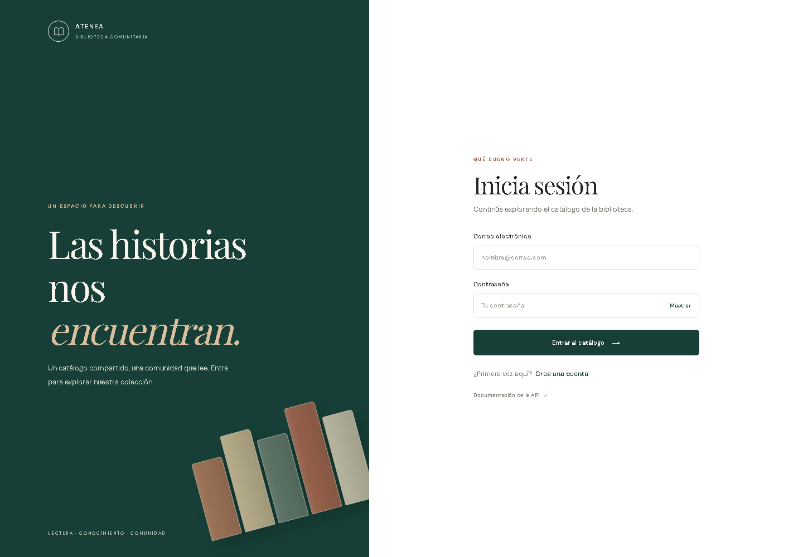
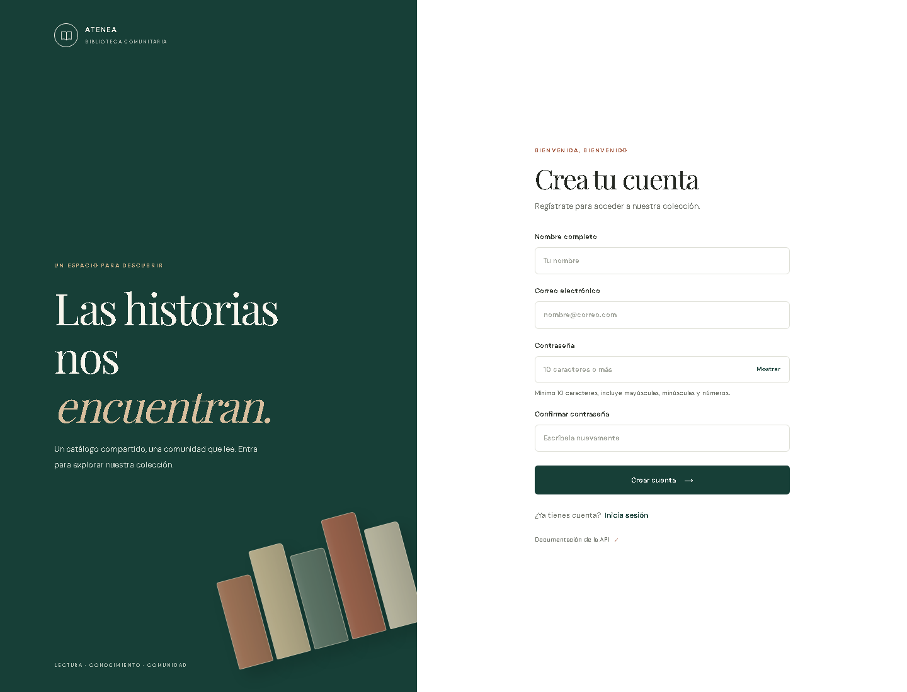
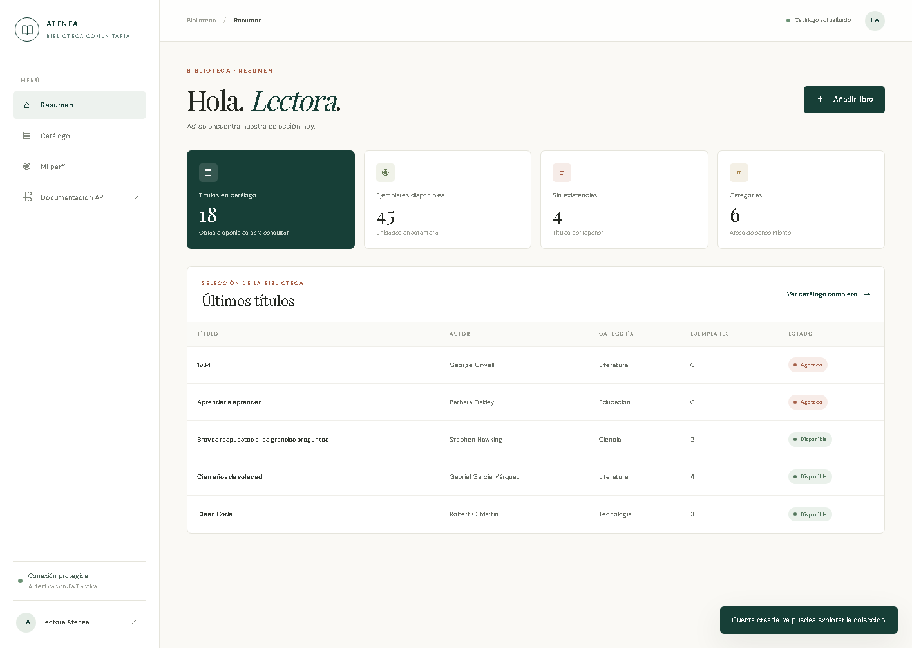
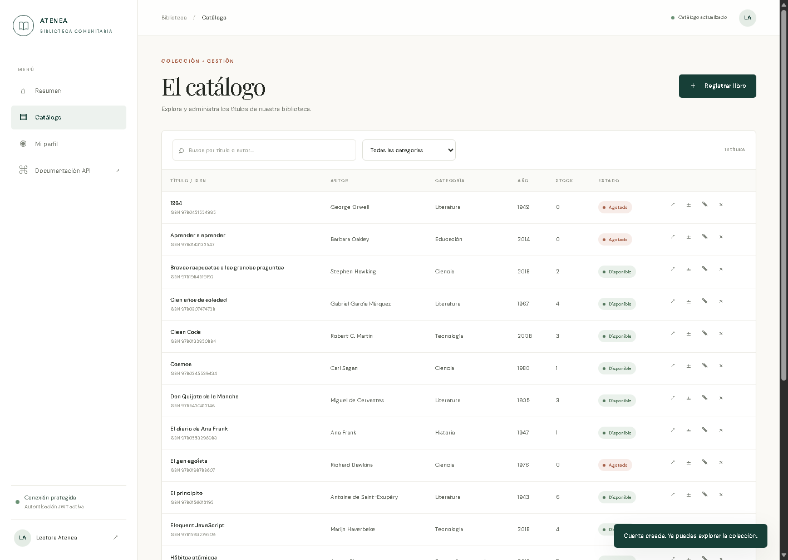
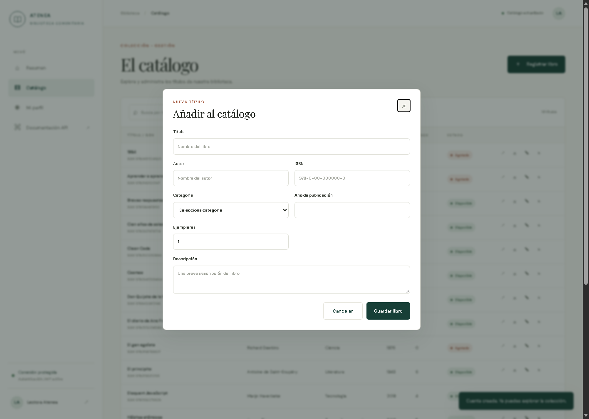
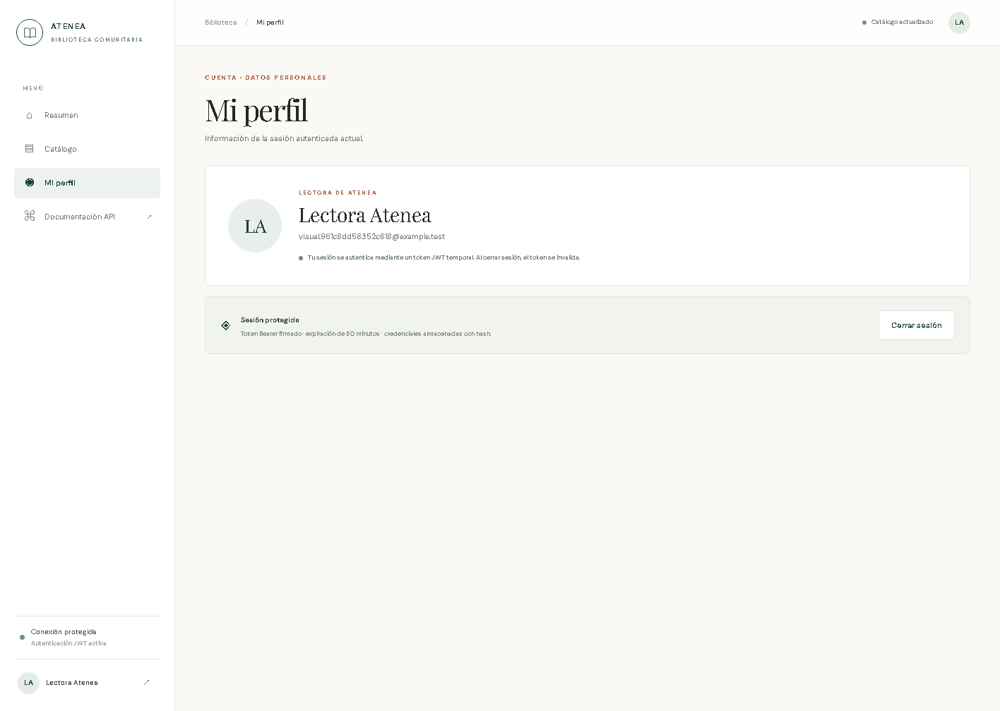
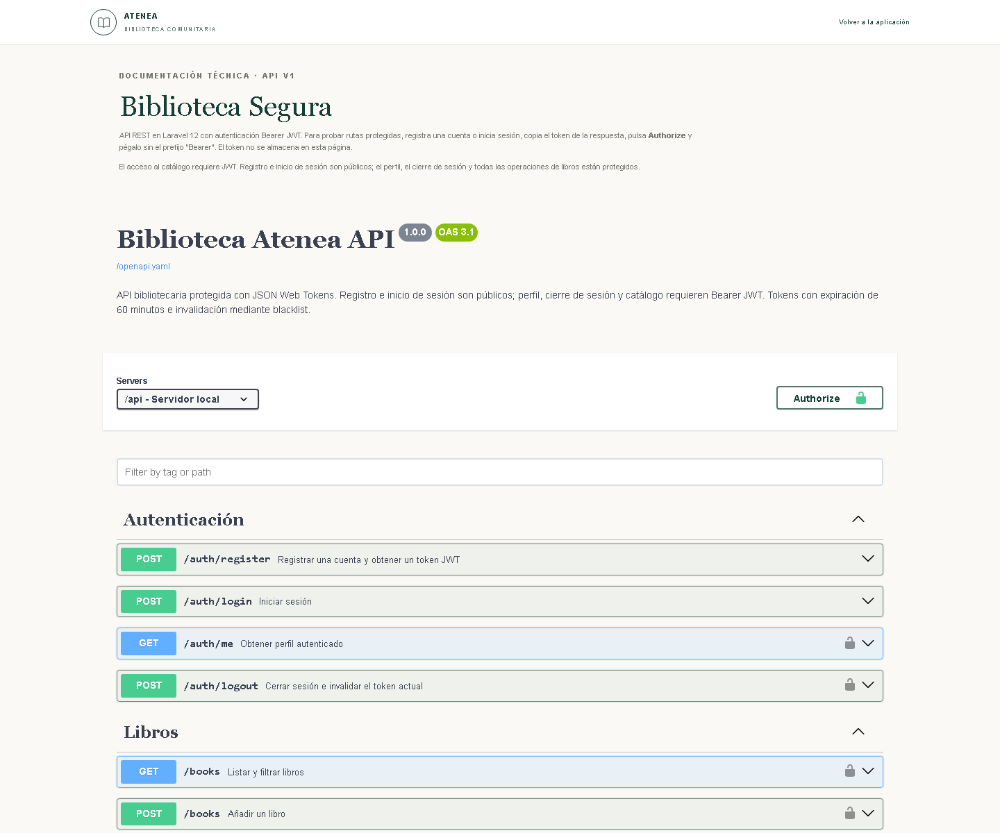

# Sistema Bibliotecario — API REST con JWT

API para el catálogo de una biblioteca comunitaria, protegida con JSON Web Tokens. Permite que las personas creen una cuenta, inicien sesión y administren el catálogo bibliográfico; las contraseñas se guardan con hash y las rutas protegidas exigen un Bearer JWT válido.

## Objetivo

Reemplazar el registro manual del catálogo por un backend centralizado y stateless. El token firmado identifica al usuario autenticado en cada solicitud sin depender de sesiones web. El alcance contempla autenticación y CRUD de libros; no incluye préstamos, lectores administradores ni roles.

## Funcionalidades

- Registro de usuario con correo único, confirmación y requisitos de contraseña.
- Inicio de sesión con respuesta genérica ante credenciales incorrectas.
- JWT firmado HS256, TTL de 60 minutos, guard `api` y blacklist habilitada.
- Perfil autenticado y cierre de sesión con revocación efectiva del token.
- CRUD protegido de libros, búsqueda por título/autor y filtro por categoría.
- Disponibilidad derivada de existencias (`stock > 0`), ISBN único y validaciones en español.
- Aplicación web integrada: registro, login, dashboard, catálogo, perfil y acciones reales contra la API.
- Protección de rutas, errores JSON, límite de 5 intentos por minuto para registro/login y CORS restringido al origen configurado.

El registro es público para esta demostración y cualquier cuenta registrada puede administrar libros. No se atribuye al sistema un rol exclusivo de bibliotecario; en producción se deberían controlar las altas y definir autorización por roles.

## Tecnologías

- Laravel 12.74.0 y PHP 8.2+.
- MySQL o MariaDB y Eloquent ORM.
- `tymon/jwt-auth` **2.3.1** y `lcobucci/jwt` 5.7.0.
- Composer, PHPUnit 11 y Laravel Pint.
- OpenAPI 3.1 / Swagger UI, Blade, HTML, CSS y JavaScript nativo.

Se instaló el paquete oficial solicitado `tymon/jwt-auth`; Composer confirmó compatibilidad con Laravel 12 (`illuminate/*` 12.x) y PHP 8.4. No fue necesario utilizar el fork alternativo.

## Requisitos previos

PHP 8.2 o posterior con `BCMath`, `Ctype`, `cURL`, `DOM`, `Fileinfo`, `JSON`, `Mbstring`, `OpenSSL`, `PDO`, `pdo_mysql`, `Tokenizer` y `XML`; Composer 2; y un servidor MySQL/MariaDB accesible. No se necesita Node.js.

## Instalación en Windows / PowerShell

```powershell
git clone https://github.com/YamiLinares/biblioteca-jwt.git
Set-Location biblioteca-jwt
composer install
Copy-Item .env.example .env
```

Crea primero una base de datos exclusiva y vacía. En una consola MariaDB/MySQL:

```sql
CREATE DATABASE biblioteca_jwt CHARACTER SET utf8mb4 COLLATE utf8mb4_unicode_ci;
```

Configura `.env` con el host, puerto y credenciales locales de esa base. Ejemplo habitual:

```dotenv
APP_NAME="Biblioteca Segura"
APP_ENV=local
APP_DEBUG=false
APP_URL=http://127.0.0.1:8015
DB_CONNECTION=mysql
DB_HOST=127.0.0.1
DB_PORT=3306
DB_DATABASE=biblioteca_jwt
DB_USERNAME=root
DB_PASSWORD=
AUTH_GUARD=api
JWT_TTL=60
JWT_BLACKLIST_ENABLED=true
CACHE_STORE=file
```

Genera las claves locales y configura el esquema y el catálogo:

```powershell
php artisan key:generate
php artisan jwt:secret
php artisan migrate --seed
php artisan test
vendor\bin\pint --test
```

No copies `APP_KEY`, `JWT_SECRET` ni las credenciales reales a archivos versionados. Arranca la aplicación luego de comprobar que el puerto elegido está libre:

```powershell
php artisan serve --host=127.0.0.1 --port=8015
```

La dirección habitual es `http://127.0.0.1:8015`. Si se cambia el puerto, ajusta `APP_URL`, `CORS_ALLOWED_ORIGINS`, `base_url` en Postman y el servidor relativo de Swagger.

## Base de datos y modelo

La tabla `users` guarda nombre, correo único y hash de contraseña. `books` guarda título, autor, ISBN de 10 o 13 dígitos, descripción, categoría, año y existencias; ISBN tiene restricción única e índice. La disponibilidad no se duplica en la base: el Resource la calcula a partir de `stock > 0`, por lo que no pueden contradecirse ambos valores.

Las categorías aceptadas son `literatura`, `ciencia`, `tecnologia`, `historia`, `educacion` y `desarrollo-personal`. El seeder inserta 18 obras ficticias o de referencia, incluidas algunas agotadas; es idempotente por ISBN. Las pruebas usan SQLite en memoria y no escriben en MySQL.

## Configuración y flujo JWT

Se usa el guard `api` con driver `jwt`, proveedor Eloquent `users` y el modelo `User` que implementa `JWTSubject`. `JWT_TTL=60` expresa 60 minutos; las respuestas devuelven `expires_in=3600` segundos. El algoritmo configurado es HS256. La lista negra está activada y almacena revocaciones en el caché de archivos local (`CACHE_STORE=file`), compartido entre solicitudes de esta instalación.

Flujo: usuario → login/registro → validación de credenciales → JWT firmado → solicitud `Authorization: Bearer <token>` → middleware `api.jwt` valida firma, expiración y blacklist → controlador protegido → JSON. Logout añade el token actual a la blacklist; no es una sesión PHP ni basta con borrarlo del cliente. La aplicación vuelve a seleccionar el token de cada petición y descarta las credenciales de guard que hubiera en memoria.

La interfaz mantiene el JWT solo en memoria de JavaScript: no lo guarda en `localStorage`, no lo pone en URLs y no lo muestra en pantalla. Al recargar la página se vuelve al login. Swagger no persiste la autorización.

## Rutas de la aplicación y API

Las solicitudes de API y sus respuestas utilizan JSON. Las rutas de lectura y escritura del catálogo, así como perfil y logout, requieren Bearer JWT.

| Método | Ruta | Descripción | JWT | Respuestas principales |
|---|---|---|---|---|
| POST | `/api/auth/register` | Crear usuario e iniciar sesión | No | 201, 422, 429 |
| POST | `/api/auth/login` | Validar credenciales y emitir token | No | 200, 401, 422, 429 |
| GET | `/api/auth/me` | Perfil del usuario autenticado | Sí | 200, 401 |
| POST | `/api/auth/logout` | Invalidar el token en uso | Sí | 200, 401 |
| GET | `/api/books` | Listar libros; acepta `search`, `category`, `per_page`, `page` | Sí | 200, 401 |
| GET | `/api/books/{id}` | Consultar un título | Sí | 200, 401, 404 |
| POST | `/api/books` | Crear libro | Sí | 201, 401, 422 |
| PUT | `/api/books/{id}` | Reemplazar todos los datos | Sí | 200, 401, 404, 422 |
| PATCH | `/api/books/{id}` | Actualizar uno o más campos | Sí | 200, 401, 404, 422 |
| DELETE | `/api/books/{id}` | Eliminar un título | Sí | 204, 401, 404 |

Un libro requiere `title`, `author`, `isbn`, `description`, `category`, `publication_year` y `stock`. PUT los requiere todos; PATCH solo valida los campos presentes. La solicitud ISBN puede incluir espacios o guiones; se normaliza y se almacena sin separadores. Stock es entero no negativo. Los campos no permitidos no se asignan en masa.

## Ejemplos PowerShell

Registrar y autenticar una cuenta de prueba:

```powershell
$base = 'http://127.0.0.1:8015/api'
$password = Read-Host 'Define la contraseña de tu cuenta de prueba'
$credentials = @{
    name = 'Ana Rivera'
    email = 'ana@example.test'
    password = $password
    password_confirmation = $password
} | ConvertTo-Json
$session = Invoke-RestMethod -Method Post -Uri "$base/auth/register" -ContentType 'application/json' -Headers @{ Accept = 'application/json' } -Body $credentials
$headers = @{ Accept = 'application/json'; Authorization = "Bearer $($session.access_token)" }
```

En producción no uses contraseñas de ejemplo ni publiques el token. El token de arriba se utiliza solo en la memoria de esa terminal.

Consultar perfil y catálogo, crear y actualizar un libro:

```powershell
Invoke-RestMethod -Uri "$base/auth/me" -Headers $headers
Invoke-RestMethod -Uri "$base/books?search=cosmos&per_page=12" -Headers $headers
$book = @{ title = 'El archivo de las palabras'; author = 'Lucía Méndez'; isbn = '9781234567897'; description = 'Una novela ficticia sobre memoria y lectura.'; category = 'literatura'; publication_year = 2021; stock = 3 } | ConvertTo-Json
$created = Invoke-RestMethod -Method Post -Uri "$base/books" -Headers $headers -ContentType 'application/json' -Body $book
$id = $created.data.id
$patch = @{ stock = 0 } | ConvertTo-Json
Invoke-RestMethod -Method Patch -Uri "$base/books/$id" -Headers $headers -ContentType 'application/json' -Body $patch
```

Eliminar, cerrar sesión y comprobar que el token revocado ya no sirve:

```powershell
Invoke-WebRequest -UseBasicParsing -Method Delete -Uri "$base/books/$id" -Headers $headers # HTTP 204
Invoke-RestMethod -Method Post -Uri "$base/auth/logout" -Headers $headers # HTTP 200
try { Invoke-RestMethod -Uri "$base/auth/me" -Headers $headers } catch { [int]$_.Exception.Response.StatusCode } # HTTP 401
```

Sin token las rutas protegidas contestan `401` con `{"message":"No autenticado."}`. Credenciales erróneas devuelven `401` genérico. Validación devuelve `422` y errores por campo. Un ISBN duplicado devuelve 422; libro inexistente, 404.

## Interfaz, Swagger y Postman

- Aplicación: `http://127.0.0.1:8015/`.
- Login: `http://127.0.0.1:8015/#/login`.
- Registro: `http://127.0.0.1:8015/#/register`.
- Swagger UI: `http://127.0.0.1:8015/docs`; especificación: `public/openapi.yaml` y `/openapi.yaml`. Usa **Authorize** para pegar el JWT temporal y probar rutas protegidas; al terminar, cierra sesión para comprobar su revocación.
- Postman: importa `docs/postman/Biblioteca-JWT.postman_collection.json` o descárgala desde `http://127.0.0.1:8015/postman/collection`. Ejecuta las carpetas en orden: Autenticación, Libros protegidos, Seguridad y cierre. El script crea un correo de prueba único y conserva temporalmente el JWT en variables de colección de Postman. La exportación no contiene tokens.

El frontend consume realmente los endpoints; todos los datos de perfil y catálogo llegan desde la API. Si se pierde el token al recargar, el login es el comportamiento esperado.

## Estructura

```text
app/Http/Controllers/Api/       AuthController y BookController
app/Http/Middleware/            Validación Bearer y errores JWT como HTTP 401
app/Http/Requests/              Registro, login, creación y actualización de libros
app/Http/Resources/             Respuestas públicas para usuario y libro
app/Models/                     User (JWTSubject) y Book (Eloquent)
bootstrap/app.php               Rutas API y respuestas JSON de errores
config/auth.php                 Guard JWT y proveedor Eloquent
config/jwt.php                  TTL, algoritmo y blacklist del paquete
database/migrations/            Usuarios y catálogo
database/factories/             Datos sintéticos de pruebas
database/seeders/               18 libros de demostración
resources/views/                Shell de la aplicación y Swagger UI
public/css, public/js/           Interfaz responsive y cliente Fetch API
public/openapi.yaml              OpenAPI 3.1 con seguridad Bearer
docs/postman/                    Colección Postman exportable
docs/capturas/                   Instrucciones para evidencia real
tests/Feature/                   Pruebas de autenticación, seguridad y CRUD
```

## Pruebas y calidad

```powershell
php artisan test
vendor\bin\pint --test
composer audit
php artisan route:list --path=api
```

Las pruebas crean usuarios y tokens JWT reales; validan hash de contraseña, login, expiración, firma distinta, JWT manipulado, logout y reutilización de token revocado. Todas las operaciones de libros se prueban con JWT y se comprueba también el rechazo de cada método sin token. SQLite en memoria mantiene estas pruebas aisladas de la base local.

## Seguridad y límites

`.env`, `.env.testing`, secretos JWT, `APP_KEY`, logs, cachés, base local, `vendor/` y archivos de respaldo se excluyen de Git. `.env.example` contiene valores de muestra sin claves. No se incluyen usuarios demo ni contraseñas administrativas fijas. El registro/login limita a cinco solicitudes por minuto y usa mensajes genéricos para credenciales.

La demostración es local y no incorpora roles: cualquier persona que consiga registrar una cuenta puede gestionar el catálogo. Para producción, restringe altas o agrega roles/autorización, usa HTTPS, un almacén de blacklist compartido y persistente para varias instancias, revisa CORS, configura rotación/gestión de claves y aplica límites y monitoreo adecuados. JWT firmado no cifra su contenido; el payload no incluye contraseñas ni datos sensibles. No expongas un servidor de desarrollo a Internet.

## Evidencias

Capturas reales de la interfaz y Swagger tomadas desde Edge:

| Pantalla | Evidencia |
|---|---|
| Inicio de sesión |  |
| Registro |  |
| Dashboard autenticado |  |
| Catálogo |  |
| Alta de libro |  |
| Perfil autenticado |  |
| Swagger UI |  |

La guía [`docs/capturas/README.md`](docs/capturas/README.md) indica cómo obtener evidencias adicionales de respuestas API y pruebas. No se incluyen capturas simuladas ni tokens visibles.

## Autora

Kenia Yamileth Landaverde Linares

GitHub: [YamiLinares](https://github.com/YamiLinares)

Actividad práctica de Kodigo.
